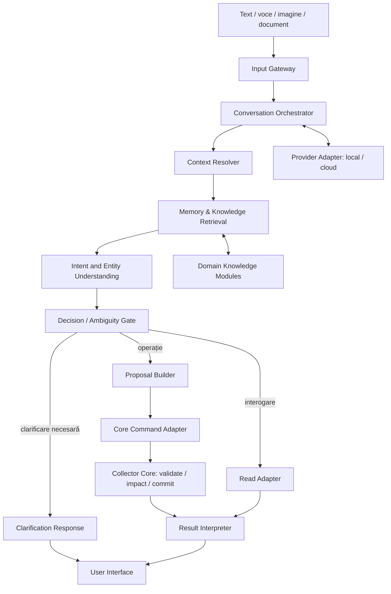
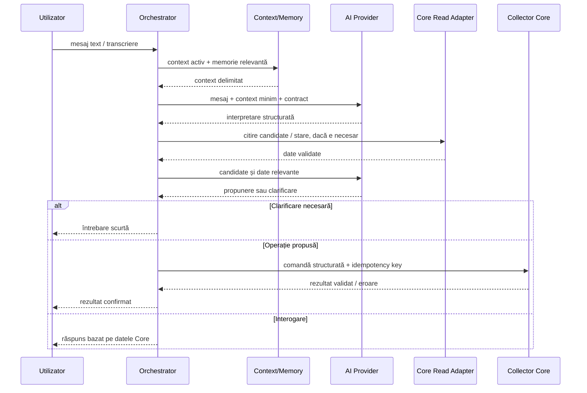

# Collector — AI Foundation v0.1

**Status:** propunere tehnică inițială, aliniată deciziilor D-001–D-044  
**Versiune:** 0.1  
**Data:** 21 noiembrie 2026  
**Scop:** definirea stratului AI și a contractului dintre AI și Collector Core, fără a muta logica de business sau persistența în AI.

---

## 1. Obiective și limite

Collector este un asistent personal universal, cu memorie, voice-first și suport pentru mai multe domenii. AI Foundation transformă intrări în limbaj natural în propuneri structurate pe care Collector Core le poate valida și executa.

### Obiective v0.1

1. Interpretarea textului și, ulterior, a transcrierii vocale.
2. Identificarea intenției: documentare, interogare, corectare, configurare sau clarificare.
3. Rezolvarea referințelor la entități folosind contextul și datele existente.
4. Construirea unei propuneri de operații conforme modelului Collector.
5. Detectarea ambiguității și solicitarea celei mai mici clarificări necesare.
6. Formularea unui răspuns după rezultatul motorului.
7. Păstrarea separării între context temporar, memorie și date operaționale.

### În afara scopului v0.1

- AI-ul nu scrie direct în baza de date sau în jurnal.
- AI-ul nu actualizează proiecții.
- AI-ul nu inventează entități, cantități, atribute sau relații.
- AI-ul nu modifică schema sau modulele de domeniu în tăcere.
- AI-ul nu garantează funcționare offline completă până când nu există un model local și un runtime local integrate.
- Nu se fixează încă un furnizor/model AI; acesta rămâne configurabil printr-un provider adapter.

---

## 2. Decizii de proiectare preluate

| Decizie | Consecință pentru AI Foundation |
|---|---|
| D-001, D-002 | AI-ul este universal și cu memorie; domeniile sunt extensii, nu motor separat. |
| D-003 | Voice-first; răspunsuri scurte implicit. |
| D-004 | Toate intrările folosesc același pipeline. |
| D-005 | AI propune; Core validează și persistă; UI prezintă. |
| D-006–D-008 | Istoricul este sursa adevărului; AI citește proiecții și istoric prin interfețe controlate. |
| D-009 | Arhitectură pregătită pentru AI local și cloud; operațiile de bază trebuie să poată funcționa offline. |
| D-011–D-016 | Granularitate progresivă; cantitățile anonime și indivizii identificați trebuie tratați distinct. |
| D-017–D-022 | Propunerile pot conține operații compuse; Core aplică atomicitate, precondiții, invariante și idempotency. |
| D-023–D-024 | Confidence al interpretării este diferită de certainty a informației din lumea reală. |
| D-025–D-036 | AI-ul trebuie să respecte atribute, temporalitate, relații și evenimente ca obiecte de prim rang. |
| D-037 | Cunoștințele de domeniu sunt module încărcabile dinamic. |
| D-038–D-041 | Context activ de 30 de minute; contextul nu contrazice date validate; clarificare minimă. |
| D-042 | Extinderile de model se propun separat și necesită validare. |
| D-043–D-044 | Auditul și corecțiile sunt gestionate prin evenimente noi de către Core. |

---

## 3. Arhitectură logică



### Principiul de execuție

- AI Foundation nu are acces la persistența internă.
- Adaptoarele sunt singurele puncte prin care AI Foundation citește sau propune operații către Core.
- Core rămâne autoritatea pentru validitate, invariante, atomicitate, idempotency, jurnal și proiecții.
- Rezultatul executării, nu intenția presupusă de AI, determină răspunsul final.

---

## 4. Componente

### 4.1 Input Gateway

Normalizează intrările fără să le interpreteze semantic.

Intrări acceptate în arhitectură:
- text;
- transcriere vocală;
- metadate audio (limbă, timestamp, calitatea transcrierii);
- imagini și documente prin referințe/atașamente.

Păstrează separat textul original și orice transcriere normalizată. Nu suprascrie formularea utilizatorului.

### 4.2 Conversation Orchestrator

Coordonează o singură interacțiune cap-coadă:
1. creează `turnId`;
2. încarcă contextul activ;
3. solicită interpretarea;
4. decide dacă este necesară clarificarea;
5. apelează read sau command adapter;
6. verifică rezultatul;
7. construiește răspunsul;
8. actualizează contextul temporar.

Orchestratorul nu execută reguli de business.

### 4.3 Context Resolver

Rezolvă referințe precum „acela”, „femela Boa Like”, „în B3” și „mai pune două” folosind, în această ordine:
1. informația explicită din mesajul curent;
2. reguli explicite;
3. context conversațional activ;
4. date istorice și relații validate;
5. deducție unică și justificabilă.

Dacă rămân două sau mai multe interpretări plauzibile, nu selectează arbitrar.

### 4.4 Intent and Entity Understanding

Produce o structură semantică intermediară:
- intenție;
- domeniu probabil;
- entități și referințe;
- cantități și unități;
- locații;
- interval temporal;
- certitudinea exprimată de utilizator;
- informații lipsă;
- alternative candidate.

Această structură nu este încă o comandă executabilă.

### 4.5 Decision / Ambiguity Gate

Clasifică rezultatul:
- `answer`: răspuns din date;
- `propose`: operație suficient de clară pentru Core;
- `clarify`: lipsește o informație critică;
- `refuse`: cerere imposibilă sau nepermisă;
- `model_extension`: modelul nu poate reprezenta cererea și trebuie propusă o extensie.

Confidence măsoară încrederea în interpretare. Certainty descrie cât de sigură este informația relatată de utilizator. Nu se confundă.

### 4.6 Memory Manager

Separă trei categorii:

| Strat | Conținut | Durată / regulă |
|---|---|---|
| Context conversațional | Referințe active, subiectul curent, intenții încă neîncheiate | Expiră după 30 min de inactivitate, conform D-038 |
| Memorie permanentă | Preferințe, reguli și informații generale utile în interacțiuni viitoare | Persistă separat; modificările trebuie auditate și controlate |
| Bază operațională | Entități, atribute, relații, evenimente, valori și proiecții | Sursa operațională de adevăr; administrată exclusiv de Core |

Memoria permanentă nu poate suprascrie sau contrazice date operaționale validate. O amintire poate ajuta la interpretare, dar nu poate crea un fapt operațional.

### 4.7 Domain Knowledge Modules

Module independente, încărcabile după context, de exemplu:
- plante;
- acvaristică;
- inventar;
- finanțe;
- proiecte;
- domenii viitoare.

Un modul poate furniza:
- vocabular și sinonime;
- tipuri de entități sugerate;
- atribute și unități uzuale;
- relații tipice;
- reguli de interpretare;
- exemple de comenzi;
- întrebări de clarificare.

Un modul nu poate schimba direct motorul sau schema activă. Extinderile se propun și se aprobă separat (D-042).

### 4.8 Provider Adapter

Interfață comună pentru modele AI locale sau cloud. Selectarea providerului nu trebuie să schimbe contractul intern.

Responsabilități:
- apel model;
- timeout și retry controlat;
- normalizare răspuns;
- raportarea indisponibilității;
- limitarea datelor trimise către cloud;
- jurnal tehnic fără a expune inutil date sensibile.

---

## 5. Pipeline canonic



### Regula critică

Nu se trimite o comandă de scriere către Core până când:
- intenția este clasificată ca operație;
- țintele și valorile obligatorii sunt rezolvate;
- nu există ambiguitate critică;
- propunerea respectă contractul;
- este atașată o cheie de idempotency.

Dacă Core respinge comanda, AI-ul explică motivul primit. Nu încearcă să ocolească validarea.

---

## 6. Contractul AI ↔ Collector Core

### 6.1 Starea actuală a motorului

În arhiva v11, `engine.js` exportă în prezent:
- `uid`, `now`;
- `emptyState`, `normDb`;
- `commit`, `replay`, `validateImport`;
- `balances`, `totalFinance`;
- `locationPath`, `activeLocation`;
- `identify`, `correctionDelta`;
- `contextIsActive`.

Acestea sunt funcții interne ale motorului actual, nu un API HTTP și nu reprezintă încă un contract stabil pentru AI. În v0.1 nu expunem AI-ului obiectul DB și nu îi oferim acces direct la `commit`.

### 6.2 Contract recomandat pentru adapter

API logic, independent de transport:

| Operație | Semnătură logică | Efect |
|---|---|---|
| Citire context | `readContext(query)` | Returnează date relevante, fără modificări |
| Căutare entități | `findEntities(criteria)` | Returnează candidate și motive de potrivire |
| Citire stare | `readProjection(query)` | Returnează proiecții validate |
| Citire istoric | `readHistory(query)` | Returnează evenimente relevante |
| Simulare | `preview(command)` | Validează și estimează impactul fără commit |
| Executare | `execute(command, idempotencyKey)` | Core validează și persistă atomic |
| Propunere extensie | `proposeSchemaExtension(extension)` | Nu activează automat extensia |

`preview` este recomandat înainte de `execute` pentru operații cu risc sau ambiguitate. Core trebuie să repete validarea la executare; preview nu este o garanție că starea nu s-a schimbat între timp.

### 6.3 Formatul propunerii

Comanda AI folosește forma operațiilor acceptată de Core: `{ operation, target?, data }`. Câmpurile de domeniu sunt obligatoriu în `data`; identificatorii trebuie rezolvați înainte de a construi operațiile.

Exemplu ilustrativ pentru „Am mutat cinci Fancy Tiger din B1 în B2”:

```json
{
  "contractVersion": "collector.command.v1",
  "turnId": "turn_from_orchestrator",
  "intent": "stock.move",
  "certainty": "certain",
  "interpretation": {
    "confidence": 0.97,
    "summary": "Transferă 5 Fancy Tiger din B1 în B2"
  },
  "operations": [
    {
      "operation": "stock.change",
      "data": {
        "populationId": "population_core_id",
        "locationId": "location_b1_core_id",
        "action": "move_out",
        "destinationId": "location_b2_core_id",
        "quantity": 5,
        "disposition": "active",
        "certainty": "certain"
      }
    }
  ],
  "idempotencyKey": "ai-turn:trusted-gateway-request-id",
  "requiresConfirmation": true
}
```

Reguli:
- `turnId` este atribuit de Orchestrator; nu este controlat de model.
- `idempotencyKey` este atribuit de gateway-ul de încredere și rămâne stabil la retry pentru aceeași trimitere; modelul nu îl alege.
- `source`, `actor`, `event.id` și timestamp-ul sunt stabilite de Core Port, nu acceptate din output-ul modelului.
- Operațiile folosesc doar allowlist-ul AI. `stock.change`, `stock.adjust`, `relation.move`, `relation.close` și `finance.record` necesită confirmare explicită.
- Core validează din nou operațiile la preview și la execute. Preview nu persistă; execute persistă înainte să publice noua stare în UI.
- Modelul nu poate furniza ID-uri arbitrare fără rezolvare prin Core Read Adapter și fără trecerea porții de ambiguitate.

Acesta este contractul logic al comenzii, nu un eveniment Core complet. Core Port construiește envelope-ul de eveniment și mapează `idempotencyKey` la `event.intentKey`.

### 6.4 Formatul răspunsului Core

```json
{
  "status": "committed",
  "eventId": "event_id",
  "duplicate": false,
  "affectedEntities": [],
  "projectionChanges": [],
  "warnings": [],
  "errors": []
}
```

Valori posibile pentru `status`:
- `preview_ok`;
- `committed`;
- `duplicate`;
- `rejected`;
- `conflict`;
- `unavailable`.

AI-ul spune „Documentat” numai după `committed` sau după confirmarea unui rezultat duplicat deja aplicat. Pentru `rejected`, `conflict` sau `unavailable`, nu afirmă că operația a reușit.

### 6.5 Interogările

Interogările nu trebuie să inventeze răspunsuri din memoria lingvistică a modelului. Valorile curente, soldurile, istoricul și agregările se citesc prin Core Read Adapter. AI-ul poate explica sau sintetiza rezultatele, dar trebuie să păstreze unitățile, perioada și incertitudinea sursei.

---

## 7. Politica de clarificare și confirmare

### 7.1 Când nu se întreabă

Nu se cere confirmare pentru o operație clară, reversibilă prin mecanismul normal de corecție și cu toate precondițiile îndeplinite, dacă politica utilizatorului permite execuția directă.

### 7.2 Când se clarifică

Se pune o singură întrebare scurtă când:
- există mai multe entități candidate;
- lipsește o locație necesară;
- cantitatea sau unitatea este ambiguă;
- referința temporală schimbă rezultatul;
- două interpretări plauzibile rămân după consultarea contextului și datelor.

Exemplu: „Te referi la B1 sau B2?”

### 7.3 Când se cere confirmare explicită

Politica de confirmare trebuie configurată după risc. Recomandare inițială:
- confirmare pentru ștergeri/închideri ireversibile (dacă vor exista), exporturi externe, partajare sau acțiuni cu impact extern;
- pentru corecții istorice, afișarea clară a evenimentului țintă și a efectelor estimate înainte de commit;
- fără confirmare redundantă pentru documentări simple, clare și locale.

D-044 rămâne aplicat exclusiv prin Core: AI poate solicita o corecție, dar nu poate rescrie evenimentul original.

---

## 8. Confidence, certainty și proveniență

Aceste câmpuri au semnificații diferite:

- `confidence`: cât de sigur este sistemul că a înțeles corect mesajul;
- `certainty`: cât de sigură este informația relatată despre realitate;
- `source`: cine sau ce a furnizat informația (`user`, `import`, `sensor`, `external_source` etc.);
- `observedAt`: când s-a produs/observat faptul, dacă este cunoscut;
- `recordedAt`: când Collector a înregistrat informația.

Exemplu: „Cred că am mutat vreo 10 pui ieri.”
- confidence poate fi ridicat dacă intenția este clară;
- certainty rămâne `uncertain`;
- cantitatea 10 nu trebuie transformată în certitudine;
- data observației și data înregistrării trebuie separate dacă sunt diferite.

---

## 9. Memorie și confidențialitate

### 9.1 Reguli

1. Contextul temporar nu este memorie permanentă.
2. Memoria permanentă nu este baza operațională.
3. Baza operațională nu este rescrisă de AI.
4. Se transmite către provider doar contextul minim necesar.
5. Pentru provider cloud, trebuie definită o politică explicită privind datele trimise, retenția și consimțământul.
6. Se păstrează proveniența informațiilor și separarea între fapt, deducție și ipoteză.
7. Utilizatorul trebuie să poată inspecta și corecta memoria, conform politicii de produs care va fi definită.

### 9.2 Contextul activ

D-038 fixează expirarea după 30 de minute de inactivitate. Expirarea afectează numai contextul conversațional. Nu șterge evenimente, entități sau memorie permanentă.

---

## 10. Local AI și Cloud AI

Arhitectura folosește același contract pentru ambele variante:

```text
Orchestrator
   |
Provider Adapter
   |------------------|
Local Provider     Cloud Provider
   |------------------|
Normalized AI Response
```

### Local AI

Avantaje:
- poate funcționa fără internet dacă modelul și resursele sunt instalate;
- datele pot rămâne local;
- latență predictibilă după încărcarea modelului.

Constrângeri:
- consum de RAM/VRAM și CPU;
- calitate și viteză dependente de hardware;
- distribuirea și actualizarea modelului.

### Cloud AI

Avantaje:
- acces la modele mai capabile;
- actualizare și scalare gestionate de provider.

Constrângeri:
- necesită internet;
- cost per utilizare;
- datele relevante părăsesc dispozitivul și necesită politică de confidențialitate.

### Strategie recomandată

În v0.1 se implementează interfața Provider Adapter și un provider de test/mock. Alegerea modelului local sau cloud se face după un benchmark pe un set de comenzi Collector reale. Nu se leagă arhitectura de un singur furnizor.

---

## 11. Erori și reziliență

| Situație | Comportament |
|---|---|
| Provider indisponibil | Nu se execută comanda; se oferă retry sau mod local dacă există |
| JSON invalid de la model | Se respinge răspunsul și se încearcă o singură reparare controlată; apoi eroare |
| Entitate ambiguă | Clarificare; fără selecție arbitrară |
| Core respinge comanda | Se explică motivul Core; fără ocolirea validării |
| Timeout după trimiterea comenzii | Se verifică idempotency/status înainte de retry |
| Dublare de mesaj | Aceeași intenție nu produce efect dublu |
| Conflict între context și date | Datele validate câștigă |
| Extensie de model necesară | Se propune separat; nu se activează în tăcere |

---

## 12. Securitate și control

Cerințe minime înainte de conectarea unui provider real:
- separarea identității utilizatorului de `actor` intern;
- autorizare pentru fiecare comandă;
- allowlist de operații permise AI-ului;
- validare strictă a schemelor JSON;
- limite pentru lungimea inputului și outputului;
- protecție împotriva prompt injection în documente și date externe;
- logarea versiunii modelului, providerului, promptului de sistem/versionării contractului și rezultatului, fără a stoca inutil secrete;
- chei API numai pe server sau într-un secret store, niciodată în codul frontend;
- audit pentru operațiile persistate prin evenimentele Core.

AI-ul nu primește niciodată credențiale sau acces generic la baza de date.

---

## 13. Set minim de teste AI

### Interpretare

- „Am pus 5 Fancy în B3” → populație/cantitate anonimă, nu cinci indivizi.
- „Am mutat femela Boa Like și încă 4 Fancy” → operație compusă.
- „Am vândut 5 Fancy” → consumă mai întâi cantitatea anonimă, conform D-016.
- „Cred că am mutat vreo 10 pui” → certainty incertă.
- „Mută-l acolo” fără antecedent unic → clarificare.
- „Schimbă locația femelei Boa Like cu Spider Legs” cu două candidate → clarificare.
- „Am mutat 5 ieri” → nu inventează tipul sau locațiile lipsă.

### Respectarea Core

- sold insuficient → Core respinge, AI nu declară succes;
- aceeași intenție retransmisă → fără dublarea efectului;
- operație compusă cu o componentă invalidă → rollback integral;
- corecție D-044 → eveniment nou, originalul păstrat;
- import invalid → AI nu încearcă să repare sau să importe în tăcere.

### Memorie și context

- contextul expiră după 30 minute;
- memoria permanentă supraviețuiește expirării contextului;
- memoria nu contrazice date operaționale;
- schimbarea domeniului plante → acvarii nu cere schimbarea manuală a modului;
- modulele de domeniu nu modifică motorul.

### Metrici

- exactitatea clasificării intenției;
- precizia identificării entităților;
- rata de clarificări necesare vs. inutile;
- rata comenzilor respinse de Core;
- rata operațiilor duplicate;
- latență p50/p95;
- cost per interacțiune pentru cloud;
- rata răspunsurilor factuale fără suport în date.

---

## 14. Plan de implementare

### Faza 0 — Contract și teste (acum)

- [x] Inventarierea funcțiilor exportate de motorul v11.
- [x] Definirea responsabilităților AI/Core/UI.
- [x] Definirea contractului logic propus.
- [x] Definirea politicii de ambiguitate și memorie.
- [ ] Validarea contractului cu implementarea Core și scenariile reale.

### Faza 1 — AI Foundation fără provider real

- [ ] `ai/orchestrator.js`
- [ ] `ai/contracts.js` (validare input/output)
- [ ] `ai/context-manager.js`
- [ ] `ai/decision-gate.js`
- [ ] `ai/provider-mock.js`
- [ ] `ai/core-adapter.js` cu operații read/preview/execute limitate
- [ ] teste automate pentru fluxurile principale

Scop: testarea pipeline-ului end-to-end fără costuri și fără dependență de internet.

### Faza 2 — Read path

- [ ] căutare entități;
- [ ] citire proiecții;
- [ ] citire istoric;
- [ ] răspunsuri bazate exclusiv pe date Core;
- [ ] tratarea provenienței și incertitudinii.

### Faza 3 — Write path controlat

- [ ] traducerea propunerii în operații interne;
- [ ] preview și impact;
- [ ] execuție atomică;
- [ ] idempotency end-to-end;
- [ ] corecții D-044;
- [ ] audit și teste negative.

### Faza 4 — Provider AI real

- [ ] benchmark local/cloud pe setul de teste;
- [ ] provider adapter concret;
- [ ] protecție prompt injection;
- [ ] politică de confidențialitate și retenție;
- [ ] monitorizare cost și latență.

### Faza 5 — Voice-first complet

- [ ] captură vocală;
- [ ] transcriere;
- [ ] pipeline unic text/voce;
- [ ] răspuns vocal;
- [ ] întrerupere și continuarea dialogului;
- [ ] funcționare degradată offline.

---

## 15. Riscuri și decizii încă deschise

| Subiect | Decizie necesară | Recomandare v0.1 |
|---|---|---|
| Provider AI | local, cloud sau hibrid | abstractizare provider; benchmark înainte de alegere |
| Transport Core | apel local, worker sau HTTP | interfață logică; transportul se decide după arhitectura aplicației |
| Autorizare | cine poate executa ce | allowlist strict; AI nu primește acces DB |
| Confirmări | ce operații cer confirmare | politică bazată pe risc |
| Memorie permanentă | format, editare, retenție | separat de DB operațională; proveniență și audit |
| Knowledge modules | format și versionare | module declarative versionate |
| Offline AI | ce model și ce hardware | nu se promite până la benchmark |
| API stabil | versiune și compatibilitate | `collector.command.v1`, versionat explicit |

---

## 16. Criterii de acceptare pentru v0.1

AI Foundation v0.1 este acceptată ca specificație când:
1. separarea AI/Core/UI este respectată în toate diagramele și exemplele;
2. contractul nu expune DB sau `commit` direct către AI;
3. toate comenzile au schemă versionată și idempotency key;
4. ambiguitatea produce clarificare, nu presupunere;
5. interogările citesc datele Core;
6. confidence și certainty sunt distincte;
7. contextul temporar, memoria permanentă și baza operațională sunt separate;
8. domeniile sunt module de cunoaștere, nu logică hardcodată în motor;
9. corecțiile respectă D-044;
10. testele negative confirmă că AI-ul nu poate ocoli Core.

**Concluzie:** v0.1 stabilește arhitectura și contractul propus. Nu afirmă că integrarea AI este deja implementată. Următorul pas tehnic este Faza 1: construirea orchestratorului și a adaptoarelor cu provider mock, apoi conectarea controlată la Core.

